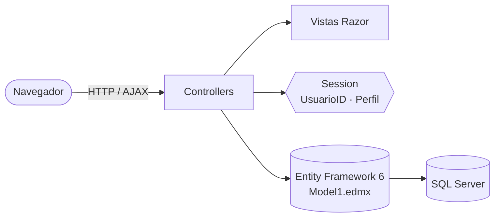
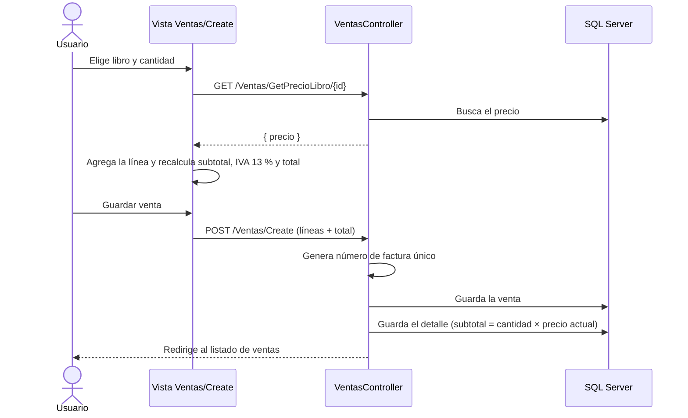
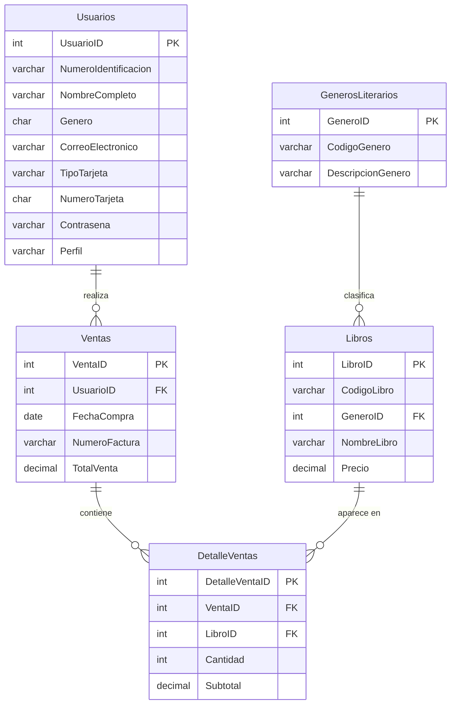

# Librería La Estantería Mágica (ASP.NET MVC 5 · Entity Framework)

Aplicación web para gestionar una librería: **catálogo de libros por género literario, usuarios con perfiles y registro de ventas con factura y detalle**. Es un **proyecto académico en pareja** de Ingeniería de Sistemas en la Universidad Americana (UAM), Costa Rica.


## Contenido
- [Capturas](#-capturas)
- [Funcionalidades](#-funcionalidades)
- [Tecnologías](#️-tecnologías)
- [Arquitectura](#️-arquitectura)
- [Flujo de una venta](#-flujo-de-una-venta)
- [Modelo de datos](#-modelo-de-datos)
- [Cómo ejecutarlo en local](#-cómo-ejecutarlo-en-local)
- [Limitaciones conocidas y próximos pasos](#️-limitaciones-conocidas-y-próximos-pasos)
- [Autoría](#-autoría)

---

## Funcionalidades

### Todos los usuarios
- **Registro e inicio de sesión** con correo y contraseña. Las cuentas nuevas reciben el perfil `Usuario`.
- **Menú según el perfil** guardado en la sesión.
- **Nueva venta** con un carrito en pantalla:
  - Se elige el libro y la cantidad, y el precio se consulta al servidor por AJAX.
  - Se agregan o quitan líneas, y se calcula el subtotal, el **IVA del 13 %** y el total en colones (₡).
  - Al guardar se genera un **número de factura alfanumérico único** de 20 caracteres y el detalle de cada línea, con el subtotal recalculado en el servidor a partir del precio del libro.
- **Mis ventas**: cada usuario ve solo sus propias ventas y su detalle.

### Administradores (perfil `Administrador`)
- **Géneros literarios**: crear, editar y consultar.
- **Libros**: crear, editar y consultar, con su género.
- **Ventas**: ver todas las ventas del sistema y su detalle, y gestionar las líneas de detalle.
- **Usuarios**: listado y edición.

---

## Tecnologías

| Capa | Tecnología |
|---|---|
| Backend | C#, ASP.NET MVC 5, .NET Framework 4.7.2 |
| Datos | Entity Framework 6 (**Database First**, `Model1.edmx`), SQL Server |
| Frontend | Razor, Bootstrap 5, jQuery, jQuery Validation, JavaScript (AJAX) |
| Seguridad | Tokens antifalsificación (`[ValidateAntiForgeryToken]`) en los formularios, control de acceso por sesión |

---

## Arquitectura

Aplicación **MVC** clásica: los controladores usan el contexto de Entity Framework generado desde la base de datos.



| Controlador | Responsabilidad |
|---|---|
| `UsuariosController` | Login (página inicial), registro, cierre de sesión, listado y edición de usuarios |
| `GenerosLiterariosController` | Mantenimiento de géneros |
| `LibrosController` | Mantenimiento de libros |
| `VentasController` | Listado según el perfil, creación de ventas, consulta de precio por AJAX y número de factura |
| `DetalleVentasController` | Líneas de detalle de una venta (solo administradores) |

```
├── App_Start/          # Rutas (inicio: Usuarios/Login), bundles y filtros
├── Controllers/        # Controladores MVC
├── Models/             # Model1.edmx y entidades generadas
├── Views/              # Vistas Razor por controlador
├── Content/ Scripts/   # Bootstrap, jQuery y estilos
├── database/           # Script de creación de la base de datos
└── Web.config          # Cadena de conexión
```

---

## Flujo de una venta



---

## Modelo de datos



---

## Cómo ejecutarlo en local

### Requisitos previos
- Windows con **Visual Studio 2019 o 2022** y la carga de trabajo *ASP.NET and web development*
- **.NET Framework 4.7.2** Developer Pack
- **SQL Server** (Express o Developer) y SQL Server Management Studio

### 1. Crear la base de datos
Ejecutá [`database/CrearBaseDatos.sql`](database/CrearBaseDatos.sql) en SSMS. Crea la base `PAV_PF_KendallBonilla_RandyArtavia`, las 5 tablas y datos de prueba, incluido un usuario **administrador** (`admin@ejemplo.com`). Cambiá su contraseña en el script antes de ejecutarlo.

### 2. Configurar la conexión
En `Web.config`, usá **autenticación de Windows** en la cadena `PAV_PF_KendallBonilla_RandyArtaviaEntities`. Reemplazá solo la parte de `provider connection string`:

```
data source=localhost;initial catalog=PAV_PF_KendallBonilla_RandyArtavia;integrated security=True;MultipleActiveResultSets=True;App=EntityFramework
```

Si tu instancia se llama distinto (por ejemplo, `.\SQLEXPRESS`), cambiá `data source`. No guardes usuarios ni contraseñas de SQL Server en este archivo.

### 3. Ejecutar
1. Abrí la solución en Visual Studio. Si faltan paquetes, hacé clic derecho en la solución → **Restore NuGet Packages**.
2. Presioná **F5**. La aplicación abre en la pantalla de inicio de sesión.

---

## Limitaciones conocidas y próximos pasos

Este es un proyecto académico. Las siguientes mejoras están identificadas.

**Seguridad**
- [ ] **Datos de tarjeta**: la tabla `Usuarios` guarda el número de tarjeta completo. Una aplicación real no debe almacenarlo; se delega a una pasarela de pago y, como mucho, se conservan los últimos 4 dígitos.
- [ ] **Contraseñas en texto plano**: guardarlas con un hash seguro (PBKDF2 o BCrypt), o migrar a ASP.NET Identity.
- [ ] **Control de acceso**: varias acciones (edición de usuarios, géneros, libros y detalle de ventas) no verifican la sesión ni el perfil. Hay que aplicar un filtro de autorización común y verificar que cada usuario solo pueda ver o editar sus propios datos.
- [ ] Eliminar del `Web.config` cualquier credencial de SQL Server.

**Correctitud**
- [ ] Recalcular el total de la venta en el servidor a partir de las líneas, en lugar de recibirlo del navegador.
- [ ] Guardar la venta y su detalle dentro de una **transacción**.
- [ ] Validar que las cantidades sean positivas y que las listas de libros y cantidades tengan el mismo tamaño.
- [ ] Agregar **existencias** de libros y descontarlas al vender.

**Calidad**
- [ ] Búsqueda y filtros en el catálogo de libros.
- [ ] Pruebas automatizadas.
- [ ] Migrar a ASP.NET Core con Entity Framework Core.

---

## Autoría

Proyecto final, Universidad Americana, 2024.

- **Kendall Bonilla Miranda** — *Desarrollador* · [LinkedIn](https://www.linkedin.com/in/kendall-bonilla-miranda) · [GitHub](https://github.com/Fiken014)
- **Randy Artavia** — *Base de Datos*
